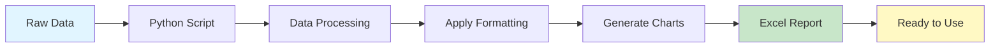

# 📊 Metrics Reporting System - Panera Bread

<div align="center">


**Automated Excel Report Generator with KPI Performance Metrics**

*Transform performance data into professional reports with conditional formatting, charts, and automated analysis*

</div>

---

## 🎯 **Project Description**

This system automates the generation of professional Excel reports for analyzing performance metrics of the Panera Bread customer service team. The script processes daily and individual performance data, applying traffic light conditional formatting, generating trend charts, and creating comparative team analysis.

### **📊 What Does It Do?**

The system takes raw performance data and transforms it into a polished, professional Excel report with:
- **Automated Data Processing**: Converts Python dictionaries into formatted Excel tables
- **Visual Analytics**: Generates charts showing performance trends over time
- **Performance Indicators**: Color-codes metrics based on target achievement
- **Multi-Sheet Reports**: Organizes data into logical sections for easy navigation

### ✨ **Key Features**

- 🔄 **Complete Automation**: Generates reports without manual intervention
- 🚦 **Smart Conditional Formatting**: Traffic light system (Green/Yellow/Red) based on goals
- 📈 **Automatic Charts**: Monthly trends and team rankings
- 📊 **Multiple Sheets**: Daily data and team analysis in separate tabs
- 💼 **Professional Format**: Tables with corporate styles and automatic formulas
- 🎨 **Visual and Intuitive**: Clear interface with representative icons and colors

### 📸 **Report Preview**

The system generates a comprehensive Excel report with two main sheets:

| Daily Metrics | Team Performance |
|:-------------:|:----------------:|
|  |  |
| Monthly KPI tracking with trend analysis | Individual employee metrics and rankings |

### **🔄 System Workflow**



**Process Flow:**
1. 📥 Input: Raw performance data (Python dictionaries)
2. 🔄 Processing: Data validation and transformation with pandas
3. 🎨 Formatting: Apply traffic light conditional formatting
4. 📊 Visualization: Generate trend charts and rankings
5. 💾 Output: Professional Excel file ready for stakeholders

---

## 🚀 **Installation and Setup**

### **System Requirements**
- 🐍 **Python 3.8+** (Recommended: Python 3.10+)
- 💻 **Operating System**: Windows, macOS, or Linux
- 📦 **Package Manager**: pip

### **Step-by-Step Installation**

1. **Clone the Repository**
   ```bash
   git clone https://github.com/ByCulichi/Culichi-Metrics.git
   cd Culichi-Metrics
   ```

2. **Create Virtual Environment** (Recommended)
   ```bash
   python -m venv venv
   
   # Windows
   venv\Scripts\activate
   
   # macOS/Linux
   source venv/bin/activate
   ```

3. **Install Dependencies**
   ```bash
   pip install -r requirements.txt
   ```

4. **Verify Installation**
   ```bash
   python to_excel.PY
   ```

### 📦 **Dependencies**

| Library | Version | Purpose |
|---------|---------|---------|
| `pandas` | >=2.0.0 | Data manipulation and analysis |
| `xlsxwriter` | >=3.0.0 | Excel file generation with formatting |
| `openpyxl` | >=3.0.0 | Additional Excel support |

---

## 📈 **Metrics and KPIs Included**

### **📅 Daily Data by Month**
- **HANDLED**: Number of calls answered
- **OIR (%)**: Offer and Information Rate
- **AHT (sec)**: Average Handle Time
- **PS & Compliance (%)**: Professional Standards & Compliance
- **RTA (%)**: Real Time Adherence

### **👥 Individual Team Analysis**
- **OIR (%)**: Offer and information rate per employee
- **QA (%)**: Quality Assurance  
- **CCA (%)**: Customer Care Advocacy
- **CARE (%)**: Customer care index
- **NICE TOUR (%)**: Service evaluation metric
- **ACS Score (%)**: American Customer Satisfaction Score
- **RTA (%)**: Real-time schedule adherence
- **PS & Compliance (%)**: Professional standards and compliance

### 🎯 **Goals and Objectives**

| Metric | Target | Type | Description |
|--------|--------|------|-------------|
| OIR (%) | ≥ 90% | Higher is better | Efficiency in offers and information |
| AHT (sec) | ≤ 630 sec | Lower is better | Optimal time per call |
| QA (%) | ≥ 85% | Higher is better | Service quality |
| RTA (%) | ≥ 85% | Higher is better | Punctuality and adherence |
| CARE (%) | ≤ 5% | Lower is better | Minimize service issues |

---

## 🎨 **Generated Report Structure**

### **📋 Sheet 1: "Daily_Data"**
```
📊 Daily Data Organized by Month
├── 📅 April 2025
│   ├── Table with professional formatting
│   ├── Automatic averages row
│   ├── 🚦 Conditional formatting (traffic light)
│   └── 📈 Trend chart OIR vs AHT
├── 📅 May 2025
│   └── [Same structure...]
└── 📅 [Other months...]
```


*The Daily Data sheet displays monthly performance metrics with color-coded cells (green for meeting targets, yellow for acceptable, red for critical) and includes automatic trend charts for visual analysis.*

> 📝 **Note**: See [Visual Guide](docs/images/VISUAL_GUIDE.md) for an ASCII representation of the report structure.

### **👥 Sheet 2: "Team_August"**
```
📊 Individual Team Analysis
├── 📋 Metrics table per employee
├── 🧮 Team averages
├── 🚦 Conditional formatting per metric
└── 📊 Ranking chart by OIR (%)
```


*The Team Analysis sheet provides individual employee performance with traffic light formatting and a horizontal bar chart ranking team members by their OIR percentage.*

---

## 🎯 **How to Use the System**

### **🔧 Basic Execution**
```bash
python to_excel.PY
```

### **📝 Data Customization**

**1. Update Daily Data:**
```python
# Find the section: daily_data = [
# Add new records following the format:
{
    'Mes': 'October', 
    'Call Date': '2025-10-01', 
    'HANDLED': 45, 
    'OIR (%)': 95.0, 
    'AHT (seg)': 580.0,
    # ... other metrics
}
```

**2. Update Team Data:**
```python
# Find the section: data_equipo = {
# Modify corresponding lists:
'Empleado': ['New Employee', ...],
'OIR (%)': [92.5, ...],
# ... other metrics
```

**3. Adjust Goals:**
```python
# Find the section: metas = {
# Modify target values:
'OIR (%)': 95.0,  # New goal
'AHT (seg)': 600.0,  # New target
```

### **🎨 Customize File Name**
```python
# Line ~282 in to_excel.PY
output_file = r'My_Custom_Report.xlsx'
```

---

## 🚦 **Conditional Formatting System**

The system uses intuitive colors to evaluate performance:

| Color | Meaning | Criteria |
|-------|---------|----------|
| 🟢 **Dark Green** | Excellent - Meets goal | ≥ 100% of target |
| 🟢 **Light Green** | Good - Close to goal | ≥ 95% of target |
| 🟡 **Yellow** | Acceptable - Needs improvement | ≥ 90% of target |
| 🔴 **Red** | Critical - Requires attention | < 90% of target |

*For metrics where "lower is better" (AHT, CARE), the criteria are inverted*

### **Example Visual**

```
OIR (%) Target: 90%
┌─────────┬──────────────┐
│ Value   │ Color        │
├─────────┼──────────────┤
│ 95.2%   │ 🟢 Dark Green│ (≥100% of 90% = ≥90%)
│ 88.5%   │ 🟢 Light Green│ (≥95% of 90% = ≥85.5%)
│ 82.0%   │ 🟡 Yellow    │ (≥90% of 90% = ≥81%)
│ 75.3%   │ 🔴 Red       │ (<90% of 90% = <81%)
└─────────┴──────────────┘
```


*The traffic light system automatically highlights performance levels, making it easy to identify areas that need attention.*

---

## 🛠️ **Maintenance and Customization**

### **📁 Code Structure**
```
to_excel.PY
├── 📦 Imports and configuration
├── 📊 Daily data (daily_data)
├── 👥 Team data (data_equipo)
├── 🎯 Goals and objectives (metas)
├── 🔧 Helper functions
├── 🎨 Main function (main)
└── 🚀 Entry point
```

### **🔧 Main Functions**
- `parse_date()`: Converts dates for sorting
- `excel_col_letter()`: Converts indexes to Excel column letters
- `add_traffic_light()`: Applies traffic light conditional formatting
- `main()`: Main report generation function

### **🎨 Style Customization**
```python
# Modify cell formats (line ~315)
fmt_header = workbook.add_format({
    'bold': True, 
    'bg_color': '#YOUR_COLOR',  # Change color
    'font_color': 'white',
    'align': 'center'
})
```

---

## 🐛 **Troubleshooting**

### **❌ Common Errors**

**1. `ModuleNotFoundError: No module named 'pandas'`**
```bash
pip install -r requirements.txt
```

**2. `PermissionError: [Errno 13] Permission denied`**
- ✅ Close the Excel file if it's open
- ✅ Verify write permissions in the folder
- ✅ Run as administrator if necessary

**3. `FileNotFoundError` or path issues**
- ✅ Verify you're in the correct directory
- ✅ Use absolute paths if there are problems

**4. Data not displaying correctly**
- ✅ Verify date format (`YYYY-MM-DD`)
- ✅ Ensure dictionary keys match
- ✅ Check that numeric data is not stored as text

### **🔍 Debug Mode**
To see more details in case of errors, modify:
```python
# Add at the end of main():
import traceback
traceback.print_exc()
```

---

## 🤝 **Contributing**

### **💡 How to Contribute**
1. 🍴 Fork the repository
2. 🌟 Create a branch for your feature (`git checkout -b feature/new-feature`)
3. 💻 Make your changes and add documentation
4. ✅ Run the tests
5. 📝 Commit your changes (`git commit -m 'Add new feature'`)
6. 📤 Push to the branch (`git push origin feature/new-feature`)
7. 🔄 Open a Pull Request

### **📋 Code Standards**
- 📝 **Documentation**: All functions must have docstrings
- 🐍 **PEP 8**: Follow Python style standards
- 💬 **Comments**: Self-explanatory code with clear comments
- ✅ **Tests**: Verify functionality before contributing

---

## 👥 **Team**

### **✨ Maintainers**
- **Christian Velasco Navarro** - *Lead Developer* - [@ByCulichi](https://github.com/ByCulichi)

### **🙏 Acknowledgments**
- Panera Bread team for the requirements
- Python community for the libraries used
- Contributors who help improve the project

---

## 📄 **License**

This project is licensed under the MIT License - see the [LICENSE](LICENSE) file for details.

---

## 📞 **Contact and Support**

### **📧 Contact**
- **Email**: christian.velasco@panera.com
- **GitHub**: [@ByCulichi](https://github.com/ByCulichi)
- **LinkedIn**: [Christian Velasco](https://linkedin.com/in/christian-velasco)

### **🆘 Getting Help**
- 🐛 **Issues**: Report bugs at [GitHub Issues](https://github.com/ByCulichi/Culichi-Metrics/issues)
- 💬 **Discussions**: Join [GitHub Discussions](https://github.com/ByCulichi/Culichi-Metrics/discussions)
- 📖 **Wiki**: Check the [Project Wiki](https://github.com/ByCulichi/Culichi-Metrics/wiki)

---

<div align="center">

**📊 Made with ❤️ for the Panera Bread team**

*Automating reports, maximizing performance*

⭐ **Don't forget to star this project if it helped you!** ⭐

</div>

---

## ⚡ **Quick Start**

### **🚀 Option 1: Automatic Setup (Recommended for new users)**
```bash
# 1. Clone the repository
git clone https://github.com/ByCulichi/Culichi-Metrics.git
cd Culichi-Metrics

# 2. Run automatic setup
python setup.py

# 3. Done! The report will be generated automatically
```

### **⚡ Option 2: Manual Setup**
```bash
# 1. Install dependencies
pip install -r requirements.txt

# 2. Generate report
python to_excel.PY
```

### **📊 Output**
- ✅ Excel file: `Reporte_Metricas_Christian_modified.xlsx`
- 📋 2 sheets: Daily data + Team analysis  
- 🚦 Automatic conditional formatting
- 📈 Trend and ranking charts

**Console Output Example:**
```
============================================================
📊 METRICS REPORTING SYSTEM - PANERA BREAD
   Automated Excel Report Generator
============================================================
🚀 Starting metrics report generation...
📊 Configuring cell formats...
📅 Generating daily data sheet...
  📊 Processing month: April
  📈 Creating trend chart for April
  📊 Processing month: May
  📈 Creating trend chart for May
👥 Generating team analysis sheet...
  🚦 Applying traffic light conditional formatting...
  📊 Creating OIR ranking chart...
✅ Excel file generated successfully: Reporte_Metricas_Christian_modified.xlsx
📂 Location: Reporte_Metricas_Christian_modified.xlsx
🎉 Process completed!

============================================================
🎊 REPORT GENERATED CORRECTLY
   The Excel file is ready to use
============================================================
```
